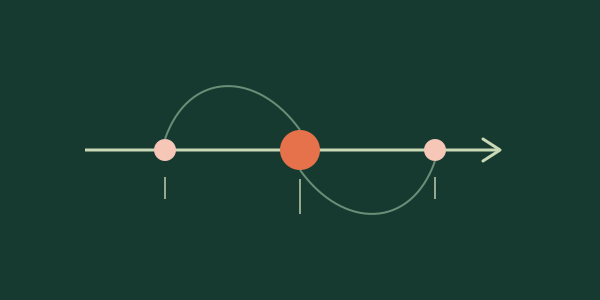
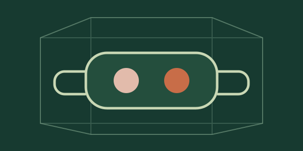
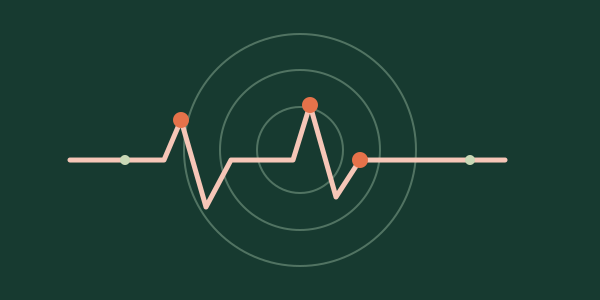

:::: {.research-page}

::: {.page-hero .page-hero--research}
::: {.page-hero__inner}
<p class="eyebrow">Duration · representation · dynamics</p>

# Research interests and *current projects*

<p class="page-hero__lead">My current research interests focus on how subjective duration is constructed across multiple scales—from how ongoing sensory changes are sampled, to the neural population dynamics that represent them, and the neurochemical signals that may modulate those dynamics. I am particularly interested in how these mechanisms interact to shape temporal judgments and distortions, and how they can be integrated within a common computational framework.</p>
:::
:::

::: {.research-projects #projects}
::: {.section-heading}
## Past and ongoing research projects {#projects-heading}
:::

```{=html}
<div class="research-card-grid">
  <a class="research-card" href="../research/mental-timeline/index.html">
    <span class="research-card__image"></span>
    <span class="research-card__body"><span class="research-card__tag">Language · movement</span><strong>Language and the mental timeline</strong><span>How can abstract concepts such as the past and future be grounded in sensorimotor experience?</span><span class="research-card__arrow" aria-hidden="true">↗</span></span>
  </a>
  <a class="research-card" href="../research/virtual-reality/index.html">
    <span class="research-card__image"></span>
    <span class="research-card__body"><span class="research-card__tag">Virtual reality · EEG</span><strong>Space and duration in virtual reality</strong><span>How do environmental constraints shape subjective duration and its neural dynamics?</span><span class="research-card__arrow" aria-hidden="true">↗</span></span>
  </a>
  <a class="research-card" href="../research/duration-geometry/index.html">
    <span class="research-card__image"></span>
    <span class="research-card__body"><span class="research-card__tag">Behaviour · EEG</span><strong>Geometry of duration representations</strong><span>Similarity judgments and an EEG oddball detection task reveal a multidimensional duration space that dynamically changes over time.</span><span class="research-card__arrow" aria-hidden="true">↗</span></span>
  </a>
  <a class="research-card" href="../research/time-consciousness/index.html">
    <span class="research-card__image"></span>
    <span class="research-card__body"><span class="research-card__tag">Current research</span><strong>Electrophysiological and electrochemical dynamics of subjective durations</strong><span class="research-card__arrow" aria-hidden="true">↗</span></span>
  </a>
</div>
```
:::

::: {.about-story}
::: {.about-story__inner}
::: {.about-story__layout}
::: {.about-story__main}
::: {.section-heading .section-heading--light}
## Research *trajectory*
:::

::: {.about-story__copy}
I defended my PhD in May 2022 at Aix-Marseille University, where my work focused on the representation of temporal order in relation to the *mental timeline*: the idea that temporal order can be mapped onto a left–right spatial axis. Drawing on theoretical frameworks such as neural reuse and Hebbian learning, I investigated the functional role of the sensorimotor system in temporal cognition.

To address this question, I developed experimental protocols using movement initiation times, mouse tracking and eye tracking, across laboratory and large-scale online studies involving more than a thousand participants in total. Overall, my PhD research suggested that the sensorimotor system actively contributes to how we represent and process temporal order.

This work led me to look more closely at what the *mental timeline* can—and cannot—tell us about how time is represented. At NeuroSpin, I joined [Virginie van Wassenhove’s group](https://brainthemind.com/team/) to study duration within the [EXPERIENCE Project](https://experience-project.eu/). Together, we developed studies combining virtual reality and EEG to examine how spatial context shapes subjective duration, and behavioural and neural measures to investigate how durations are represented.

In September 2025, I joined the Laboratoire de Psychologie et NeuroCognition, working with [Nathan Faivre](https://nfaivre.gitlab.io/) on the VOLTA project. Since June 2026, I have pursued this work through **MIND**, my Marie Skłodowska-Curie Actions Global Postdoctoral Fellowship. MIND brings together behavioural temporal judgments, intracranial electrophysiology and voltammetry to investigate how neural and dopamine dynamics relate to the duration of conscious experience. I am currently based in the [Kishida Lab](https://www.kishidalab.com/) at Wake Forest University School of Medicine, where I am training in human voltammetry.

In parallel, I’ve also had the chance to join a project in the Kishida Lab that I’m particularly excited about: studying neurochemical dynamics during music listening. Working with the team, I am developing encoding models to explore whether the acoustic and rhythmic structure of music helps predict moment-to-moment dopamine fluctuations, with further questions about the contribution of musical surprise and uncertainty.

More broadly, my goal is to develop an integrative research programme connecting cognitive, electrophysiological and electrochemical levels of explanation to understand how we perceive, feel and represent duration. In the longer term, I hope to extend this work to questions about temporal cognition in conditions such as Parkinson’s disease, schizophrenia and ADHD.

I love the collective side of research: discussing a puzzling result, learning a new method from a colleague, or working out how to turn an idea into an experiment. There is still so much I want to learn, and I’m always happy to talk science—please feel free to [get in touch](../contact/index.qmd).
:::
:::

<aside class="interests-panel" aria-label="Personal interests">
  <p class="eyebrow">Outside the lab</p>
  <h2>Interests</h2>
  <ul>
    <li><a href="https://plato.stanford.edu/entries/scientific-method/">Science ↗</a></li>
    <li><a href="https://pubmed.ncbi.nlm.nih.gov/40049759/">Sport ↗</a></li>
    <li><a href="https://open.spotify.com/playlist/3y354jn6kSoPICjFf4vPlZ?si=934af433e5cb4a9b">Music (a lot of music) ↗</a></li>
    <li>Cooking</li>
  </ul>
</aside>
:::
:::
:::

::::
