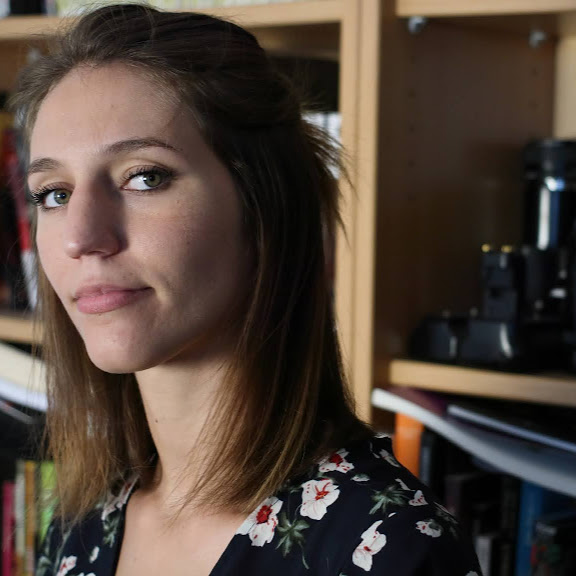

:::: {.home-shell}

::: {.home-hero}

::: {.home-hero__copy}

Neuropsychologist &amp; cognitive neuroscientist

# Camille *Grasso* {#home-title}

::: {.home-hero__role}
Marie Skłodowska-Curie Actions Global Postdoctoral Fellow
:::

::: {.home-hero__affiliations}

Winston-Salem (NC)
Wake Forest University
School of Medicine

Grenoble (France)
LPNC
Université Grenoble Alpes · CNRS

:::

:::

::: {.home-hero__portrait}

:::

:::

::: {.research-overview #research}

## Research interests

::: {.research-overview__copy}

I am a qualified neuropsychologist and cognitive neuroscientist trying to understand how humans make sense of time. I am especially interested in how we represent temporal information, why the same interval can be experienced differently, and how these experiences emerge from neural dynamics.

I am currently a Marie Skłodowska-Curie Actions Global Postdoctoral Fellow, working between the [Kishida Lab](https://www.kishidalab.com/) at Wake Forest University School of Medicine and the Laboratoire de Psychologie et NeuroCognition (LPNC, Université Grenoble Alpes, CNRS) with [Nathan Faivre](https://nfaivre.gitlab.io/). My current work brings together behavioural approaches, electrophysiology and human voltammetry to investigate the neural and neurochemical mechanisms of subjective duration.

More broadly, I am trying to build a better understanding of how temporal representations are shaped by context, organised in the mind and brain, and transformed across different levels of neural organisation. I am still learning a lot along the way, which is probably one of the things I enjoy most about research. I like discussing ideas, learning new methods and figuring things out with others, so please feel free to [get in touch](contact/index.qmd).

:::

[About & Research ↗](about/index.qmd){.text-link .research-overview__link}

:::

::: {.home-footer}
::: {.home-footer__name}
Camille Grasso
:::
::: {.home-footer__contact}
[Get in touch ↗](contact/index.qmd)
:::
:::

::::
