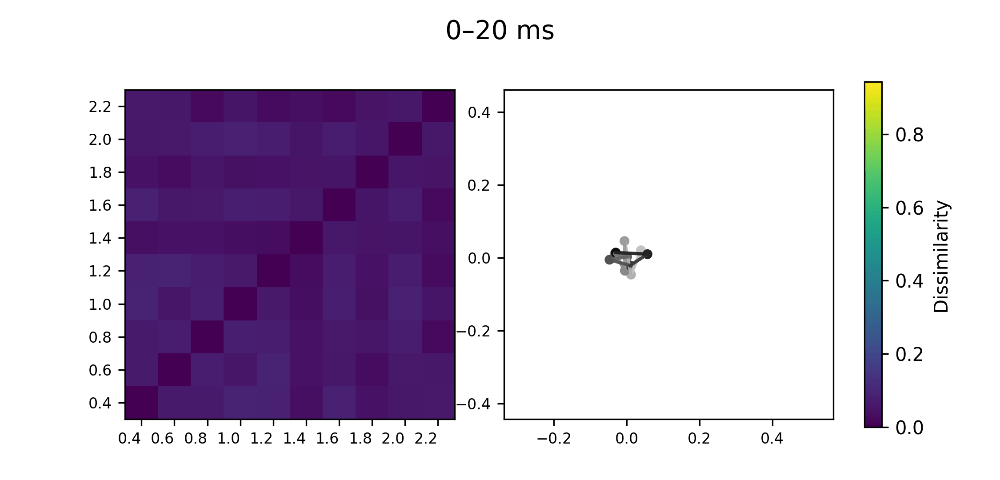
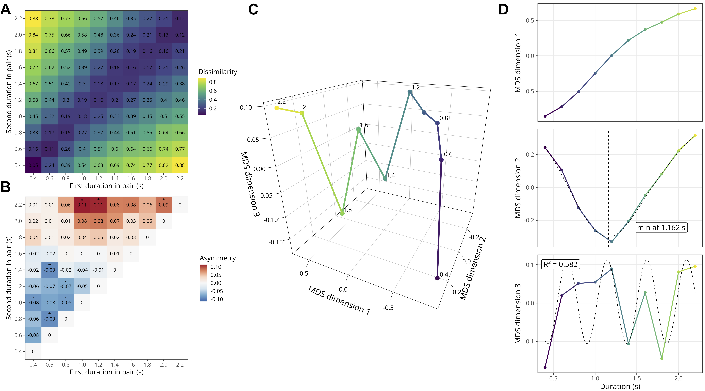

:::: {.project-page .project-page--geometry}

::: {.page-hero .page-hero--project}
::: {.page-hero__inner}

Similarity judgments · EEG

# Geometry of *duration representations*

How are durations organised in the mind and brain? Similarity judgments and an EEG oddball detection task reveal a richer structure than a single timeline.

<a class="text-link" href="../../about/index.qmd#projects">← All research projects</a>
:::
:::

::: {.project-content}
::: {.project-content__inner}

If durations can be ordered from short to long, does that mean that we represent them along a single mental timeline? To address this question, the same participants judged the similarity of auditory durations and later completed an EEG experiment with the same intervals. Using **representational similarity analysis (RSA)**, we compared the structure of behavioural judgments and neural activity with competing models of duration representation.

The behavioural data revealed a structure richer than a simple line, combining a monotonic magnitude component with contextual and recurrent structure. A generalised helical model captured these properties well, although it could not be clearly distinguished from a nonlinear Power model. The results therefore point to a multidimensional organisation of duration rather than to one definitive geometry.

The EEG results showed that this organisation also changes over time: an early compressed, approximately logarithmic representation was followed by a richer geometry that became more closely aligned with behavioural similarity around 300 ms after duration offset. Together, these findings suggest that duration representations are both **structured and dynamically transformed** in the brain.

Follow-up studies are under way, including a related task with judgments of sound pitch and tests of new hypotheses about how durations are represented.

<figure class="project-figure project-figure--wide">
  
  <figcaption><strong>Neural geometry over time.</strong> Successive time windows show the group-average EEG similarity structure (left) and its two-dimensional projection (right) after stimulus offset.</figcaption>
</figure>

<figure class="project-figure project-figure--wide">
  
  <figcaption><strong>Behavioural geometry of duration.</strong> The similarity matrix, three-dimensional embedding and component profiles from the existing manuscript figure. Open the image for a larger view. Source: Grasso, Nalborczyk &amp; van Wassenhove, preprint linked below.</figcaption>
</figure>

## People and publications

I developed this work with **Ladislas Nalborczyk** and **Virginie van Wassenhove** during my postdoctoral research at NeuroSpin. The manuscript is under revision; a preprint is available.

- [Uncovering the representational geometry of duration — publication summary](../../publications/geometry/index.qmd)
- [Read the preprint](https://www.biorxiv.org/content/10.64898/2026.03.29.715088v3)

<a class="text-link" href="../../about/index.qmd#projects">← Back to research projects</a>

:::
:::

::::
