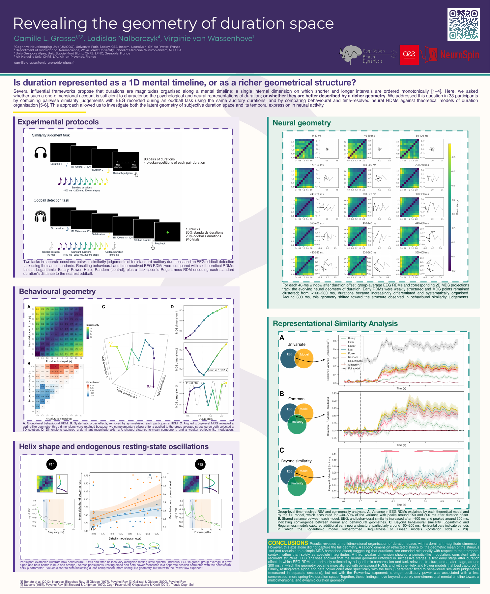

::: {.talk-article}

I presented this poster at [CCN 2026](https://2026.ccneuro.org/), sharing the results of our preprint, [*Uncovering the representational geometry of duration*](https://www.biorxiv.org/content/10.64898/2026.03.29.715088v3).

## Poster

[Open poster (PDF) ↗](){.talk-preview-link target="_blank" rel="noopener noreferrer"}

[Open conference abstract (PDF) ↗](){target="_blank" rel="noopener noreferrer"}

[Event website ↗](){target="_blank" rel="noopener noreferrer"}

[← All talks](../index.qmd){.text-link}

:::
