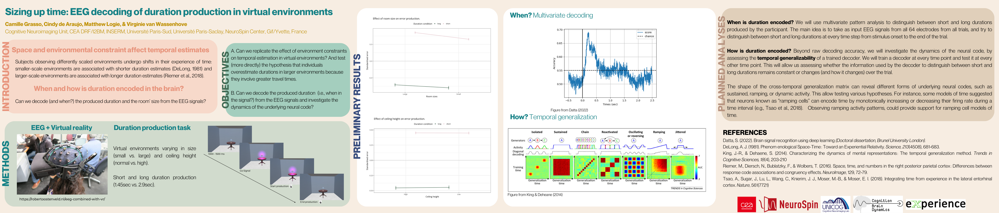

::: {.talk-article}

## Poster

[Open poster (PNG) ↗](){.talk-preview-link target="_blank" rel="noopener noreferrer"}

[Event website ↗](){target="_blank" rel="noopener noreferrer"}

[← All talks](../index.qmd){.text-link}

:::
