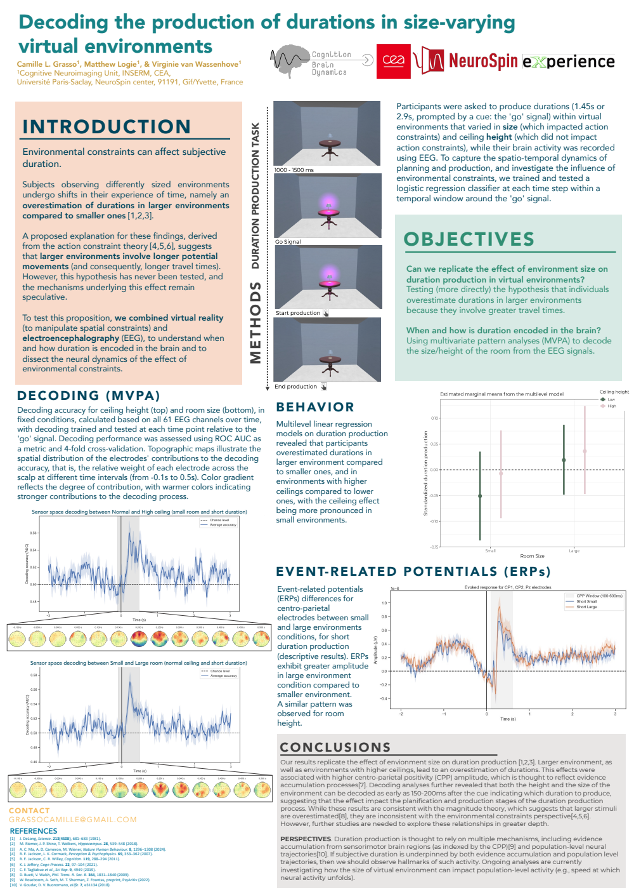

::: {.talk-article}

In this poster, we show that participants tend to overestimate durations in larger virtual environments or those with higher ceilings. EEG decoding analyses revealed that spatial features influence early brain dynamics during the planning and production of durations.

## Poster

[Open poster (PDF) ↗](){.talk-preview-link target="_blank" rel="noopener noreferrer"}

[Event website ↗](){target="_blank" rel="noopener noreferrer"}

[← All talks](../index.qmd){.text-link}

:::
