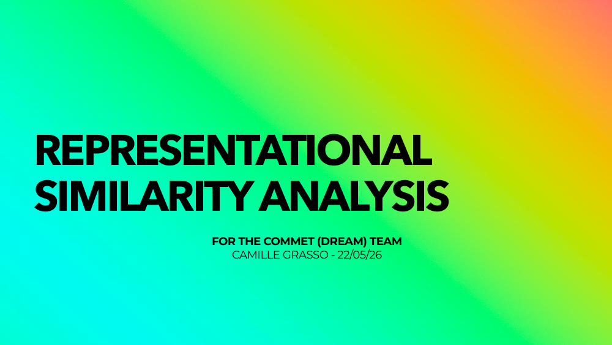

::: {.talk-article}

These slides are a modest and certainly non-exhaustive introduction to Representational Similarity Analysis (RSA). They cover the logic of RDMs, model comparison, dissimilarity measures, statistical inference, and a few (more concrete) examples.

The final example uses behavioural similarity judgments and EEG data from our recent preprint on the representational geometry of durations: [Grasso, Nalborczyk, & Van Wassenhove, 2026](https://www.biorxiv.org/content/10.64898/2026.03.29.715088v3).

They were initially prepared for a lab tutorial, so the goal is not to provide a complete technical reference, but rather to make RSA feel a bit more intuitive.

## Slides

[Open slides (PDF) ↗](){.talk-preview-link target="_blank" rel="noopener noreferrer"}

[← All talks](../index.qmd){.text-link}

:::
